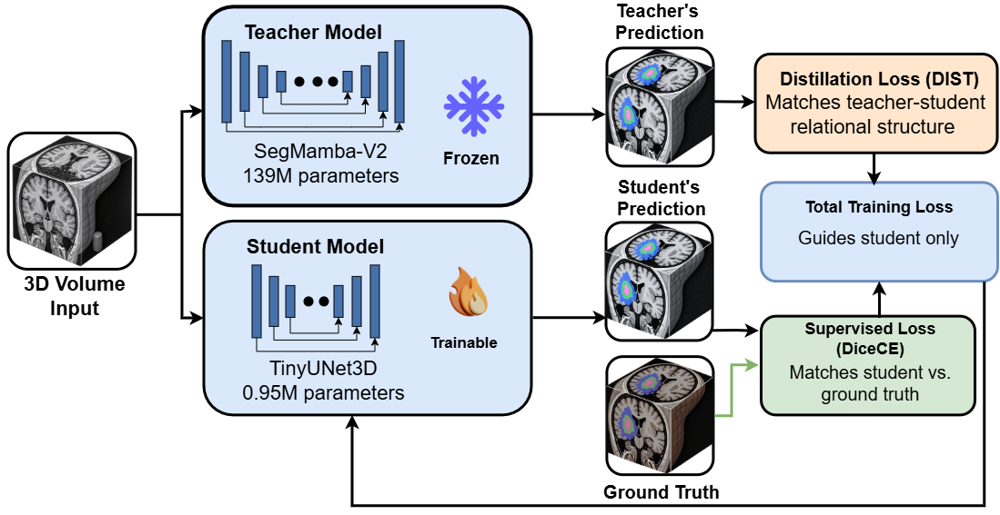

# TinyUNet3D-DIST: Ultra-Lightweight 3D Medical Image Segmentation via Knowledge Distillation in Label-Scarce Domains

Code for our ISBI paper. A single **139M-parameter SegMamba-V2 teacher** is distilled with a
correlation-based (**DIST**) loss into **TinyUNet3D**, a **0.957M-parameter** CNN student built from
depthwise-separable 3D convolutions (about **145x smaller**). We evaluate on BraTS 2023, MSD Spleen and MSD
Hippocampus, and study how the benefit of distillation depends on the amount of labelled data with a
controlled data-fraction sweep on BraTS 2023 (5% to 100% of the training set).

<p align="center">
  
</p>

The teacher is frozen. The student is trained with `L = DiceCE(student, ground truth) + lambda * L_DIST`,
where `L_DIST` matches the *relational structure* of the teacher's and student's class probabilities
instead of the probabilities themselves (see [`losses/dist_loss.py`](losses/dist_loss.py)).

## Main findings

* The student retains 99.2%, 98.8% and 100.1% of the teacher's Dice on Spleen, Hippocampus and BraTS 2023,
  with about 145x fewer parameters and 6.6-17.8x fewer FLOPs.
* With the **full** training labels, DIST changes the student's Dice by less than 0.3 points on every dataset
  (+0.24 Spleen, -0.29 Hippocampus, +0.01 BraTS), so most of the student's accuracy comes from its architecture
  and supervised training.
* The benefit appears when labels are scarce: on BraTS 2023, DIST improves Dice by +0.018 (5% of the training
  data) and +0.017 (10%); the gain is about +0.005 at 25-50% and vanishes at 100%.

## Results

Test sets, fixed splits; students are the mean of 3 seeds. Student FLOPs = 2 x MACs at each dataset's training patch.

| Dataset | Model | Params (M) | FLOPs (G) | Dice (%) |
|---|---|---:|---:|---:|
| MSD Spleen | SegMamba-V2 teacher | 138.8 | 1566 | 96.84 |
| MSD Spleen | TinyUNet3D, no KD | 0.956 | 235.7 | 95.86 |
| MSD Spleen | TinyUNet3D + DIST | 0.956 | 235.7 | 96.10 |
| MSD Hippocampus | SegMamba-V2 teacher | 138.8 | 87.0 | 88.68 |
| MSD Hippocampus | TinyUNet3D, no KD | 0.957 | 4.9 | 87.88 |
| MSD Hippocampus | TinyUNet3D + DIST | 0.957 | 4.9 | 87.59 |
| BraTS 2023 | SegMamba-V2 teacher (reproduced) | 138.8 | 3730.7 | 88.88 |
| BraTS 2023 | TinyUNet3D, no KD | 0.957 | 211.5 | 88.95 |
| BraTS 2023 | TinyUNet3D + DIST | 0.957 | 211.5 | 88.96 |

The comparison with published methods (UNETR, nnU-Net, CoTr, ReCo-KD, Swin UNETR, SegResNet, Swin UNETR-V2,
SegMamba) is in the paper and in [`results/results_table.tex`](results/results_table.tex). Those numbers come from
the cited papers (own protocols) and are only a rough guide.

**Data-fraction sweep (BraTS 2023, test Dice):**

| Training data | No KD | + DIST | DIST gain |
|---:|---:|---:|---:|
| 5% | 0.8494 | 0.8677 | +0.0183 |
| 10% | 0.8628 | 0.8794 | +0.0166 |
| 25% | 0.8822 | 0.8870 | +0.0048 |
| 50% | 0.8882 | 0.8945 | +0.0063 |
| 100% | 0.8895 | 0.8896 | +0.0001 |

100% = 876 training cases. Raw values: [`results/frac_sweep_brats.csv`](results/frac_sweep_brats.csv).
All result tables: [`results/results_table.md`](results/results_table.md).

## Protocol

* **Splits are fixed and shared by teacher and students.** BraTS 2023: 876 train / 125 val / 250 test
  (`brats/fixed_split_loader.py` asserts the sizes and non-overlap). MSD Hippocampus: fixed seeded 70/10/20
  split. MSD Spleen: 29 / 4 / 8.
* **Checkpoints are selected on the validation split; the test split is scored once.** The spleen scorer refuses
  to re-score a checkpoint unless `FORCE=1`.
* **The teacher is trained by us on the same fixed split** (`teacher/`). The officially released BraTS
  checkpoint is not used: it was trained on cases that overlap our test split.
* Students: TinyUNet3D with `base=64` (channel widths 64/128/256/512, 0.957M parameters), SGD (lr 1e-2,
  momentum 0.99, Nesterov, weight decay 3e-5, poly schedule), DiceCE supervised loss, batch size 2,
  augmentation on. DIST: `T = 1`, `beta = gamma = 1`, `lambda = 1`, with the intra-class term computed over
  foreground voxels only. The Spleen student uses a single-logit (sigmoid) head, so DIST is applied in its
  equivalent two-class form.
* Epochs as set in the scripts: BraTS students 300 (`brats/`), MSD students 250 (`msd/`, `spleen/`),
  BraTS teacher 1000 (`teacher/`).

## Repository layout

```
models/student_unet3d.py        TinyUNet3D (depthwise-separable 3D U-Net, base=64 -> 0.957M params)
losses/dist_loss.py             standalone DIST loss (foreground-masked Pearson inter + intra)
brats/                          BraTS 2023: fixed split loader, student trainers (no-KD / KL / DIST, data-fraction
                                sweep), evaluation scripts, SLURM launchers
msd/                            MSD (Hippocampus, Spleen): config, preprocessing, teacher + student trainers, test scorer
spleen/                         final Spleen student pipeline (teacher-matched preprocessing, TTA + post-processing)
teacher/                        reproduction of the SegMamba-V2 teacher on the fixed BraTS split
tools/compute_flops.py          student params / FLOPs (FLOPs = 2 x MACs); does NOT cover the Mamba teacher
tools/plot_frac_sweep.py        data-fraction figure
results/                        result tables (md / tex) and the sweep values (csv)
assets/framework.png            framework figure
```

## Setup

The scripts import `light_training` and `models_segmamba` from the official SegMamba / SegMamba-V2 code base,
which is **not included** here. Clone it, install its requirements plus `requirements.txt`, and copy the files you
need into its dataset folders (for BraTS: `models/student_unet3d.py` and `brats/*.py` into `SegMamba-V2/brats23/`).
Datasets and checkpoints are not distributed; paths are set with environment variables (`BRATS_DATA`, `SPLIT_DIR`,
`TEACHER_CKPT`, `TASK_DIR`, `PP_DIR`, ...) or constants at the top of each script.

Check the student size:

```bash
python models/student_unet3d.py      # base=64 -> 956,912 parameters (0.957M)
python losses/dist_loss.py           # smoke test of the DIST loss
```

## Usage

**Always pass `STUDENT_BASE=64`** to the BraTS and MSD trainers. Their default is 32 (0.262M parameters),
which is not the paper's model. The BraTS evaluation scripts assume base 64.

BraTS 2023 (run from `SegMamba-V2/brats23/`). `DATA_FRAC=1.0` is the full-data run:

```bash
KD_MODE=none SEED=1 DATA_FRAC=0.25 STUDENT_BASE=64 python train_student_frac_brats.py   # no-KD baseline
KD_MODE=dist SEED=1 DATA_FRAC=0.25 STUDENT_BASE=64 python train_student_frac_brats.py   # DIST
python eval_frac_all.py       # test-set Dice for all finished sweep runs -> CSV
python eval_full_all.py       # test-set Dice for the full-data runs
```

`train_student_brats_full.py` / `train_student_dist_brats_full.py` are the earlier full-data trainers (the DIST one
uses the *unmasked* variant); `train_student_frac_brats.py` uses the foreground-masked DIST described above.

MSD Hippocampus (and the older Spleen pipeline):

```bash
TASK=hippocampus KD_MODE=dist SEED=1 STUDENT_BASE=64 python msd/train_student_msd.py
TASK=hippocampus ARCH=student STUDENT_BASE=64 MODEL_PATH='logs/.../best_model_*.pt' SPLIT=val  python msd/eval_msd_test.py
TASK=hippocampus ARCH=student STUDENT_BASE=64 MODEL_PATH='logs/.../best_model_*.pt' SPLIT=test python msd/eval_msd_test.py
```

MSD Spleen (final pipeline):

```bash
KD_MODE=dist SEED=1 python spleen/spleen_student.py                 # trains, selects on val
MODE=test KD_MODE=dist SEED=1 python spleen/spleen_student.py       # scores the test split once
```

Teacher reproduction on the fixed BraTS split: see [`teacher/README_teacher_reproduction.md`](teacher/README_teacher_reproduction.md).

## Notes and limitations

* The data-fraction analysis is done on BraTS 2023 only (one teacher, one student architecture).
* At full labels DIST is on par with the no-KD student; it should be used when labels are scarce.
* Teacher FLOPs in the tables are not produced by `tools/compute_flops.py` (it covers the student only).
* Spleen has 41 labelled cases (8 test cases), so small differences on it are within noise.

## Citation

The paper is under review. Citation details will be added here.

```bibtex
@inproceedings{ullah2026tinyunet3d,
  title     = {Ultra-Lightweight 3D Medical Image Segmentation via Knowledge Distillation in Label-Scarce Domains},
  author    = {Ullah, Rahim and Abbas, Hasan and Nabi, Syed Waqar},
  year      = {2026}
}
```

## License

MIT, see [`LICENSE`](LICENSE). The datasets (BraTS 2023, Medical Segmentation Decathlon) have their own licenses.
